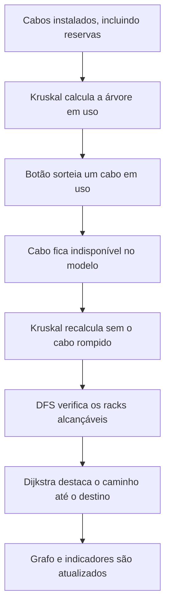

# FibraMínima

**Trabalho acadêmico de Algoritmos em Grafos:** simulação visual do cabeamento de um prédio, com cálculo de uma árvore geradora mínima e recuperação de caminhos após o rompimento de um cabo.

O projeto foi desenvolvido em **Python**, com **Streamlit** para a interface e **Plotly** para desenhar os grafos. Os algoritmos são implementados no próprio código, sem uma biblioteca pronta de algoritmos em grafos. A aplicação também pode ser executada com **Docker**.

## Problema proposto

Como conectar todos os racks de um prédio usando uma rede de menor comprimento e demonstrar alternativas quando um cabo rompe?

Uma árvore geradora mínima conecta todos os pontos com o menor peso total, mas não oferece redundância: remover qualquer uma de suas arestas desconecta a árvore. Para demonstrar a recuperação, a infraestrutura simulada possui cabos de reserva já instalados. Após uma ruptura, o programa recalcula a árvore usando os cabos restantes.

O objetivo é estudar **modelagem, otimização e conectividade em grafos**, com uma demonstração que possa ser explicada em sala de aula.

## Modelagem como grafo

A demonstração principal usa um **grafo simples, ponderado e não direcionado**.

| Conceito do grafo | Representação no projeto |
| --- | --- |
| Vértice | Um rack de distribuição |
| Aresta | Um trecho de cabo entre dois racks |
| Peso | Comprimento do trecho, em metros |
| Vértice de origem | Rack principal `1A` |
| Ciclo | Um conjunto de trechos que permite uma rota alternativa |
| Árvore geradora mínima, ou MST | Rede que conecta todos os vértices com a menor soma dos pesos |

Os cabos permitem comunicação nos dois sentidos. Os andares agrupam os racks no desenho; **cada rack é um vértice**, e não o andar inteiro.

Como o preço por metro é igual para todos os cabos e positivo, minimizar o comprimento também minimiza o valor equivalente:

```text
Comprimento em uso = soma dos pesos das arestas escolhidas
Valor equivalente = comprimento em uso × preço por metro
```

Esse valor representa a árvore em uso. **O custo físico dos cabos já instalados não muda quando a rota muda.**

## Executar com Docker

Requisitos: Git e Docker com Docker Compose. No Windows, mantenha o Docker Desktop aberto em modo de contêineres Linux.

```bash
git clone https://github.com/Kalel-9/FibraMinima.git
cd FibraMinima
docker compose up --build
```

Acesse **[http://localhost:8501](http://localhost:8501)**.

Para encerrar e remover o contêiner:

```bash
docker compose down
```

O Compose publica a porta somente no computador local. A primeira execução precisa baixar a imagem Python e as dependências.

### Executar diretamente com Python

Use **Python 3.13**, a mesma versão utilizada na imagem Docker.

No PowerShell, dentro da pasta do projeto:

```powershell
python -m venv .venv
.\.venv\Scripts\python -m pip install -r requirements.txt
.\.venv\Scripts\python -m streamlit run app.py
```

No Linux ou macOS:

```bash
python3 -m venv .venv
.venv/bin/python -m pip install -r requirements.txt
.venv/bin/python -m streamlit run app.py
```

## Como usar

### Prédio de exemplo

A primeira guia apresenta um prédio fixo de quatro andares:

| Andar | Racks, ou vértices | Trechos internos, ou arestas |
| --- | --- | --- |
| 1º | 2: `1A` e `1B` | 1 |
| 2º | 3: `2A` a `2C` | 3 |
| 3º | 4: `3A` a `3D` | 4 |
| 4º | 5: `4A` a `4E` | 5 |

São **14 vértices e 19 arestas**: 13 trechos internos e seis ligações entre andares. O rack principal `1A` está incluído nos 14 vértices.

Há dois trajetos verticais distintos, um em cada extremidade dos andares. Os andares com pelo menos três racks possuem um anel interno. Essas conexões preparam o grafo para continuar conectado após a remoção de qualquer cabo individual.

Ao lado do grafo, é possível:

- Alterar o **Preço por metro (R$)**.
- Clicar em **Romper cabo aleatório**.
- Clicar em **Restaurar rede**.
- Escolher o **Andar de destino** e o **Rack para acompanhar**.

### Montar meu prédio

A segunda guia funciona de forma independente e começa com dois andares, com dois e quatro racks, respectivamente.

1. Clique em **Adicionar andar**.
2. Confira o próximo número, definido automaticamente.
3. Escolha a **Quantidade de racks** e clique em **Salvar andar**.
4. Use os mesmos controles de rompimento, restauração, preço e destino.

Os andares são consecutivos, sem lacunas. Se já existem três andares, o próximo será o quarto. **Remover último andar** remove apenas o andar do topo.

O construtor aceita de **2 a 8 andares**, com **2 a 10 racks por andar**. Os mínimos mantêm dois trajetos verticais distintos e as conexões de reserva.

As distâncias entre racks vizinhos são sorteadas entre **8 e 16 metros**, por padrão. É possível ajustar os limites em **Faixa das distâncias aleatórias**.

- Com quatro racks em um andar, são sorteadas três distâncias entre vizinhos.
- O cabo de fechamento do anel usa a soma desses trechos e pode ultrapassar o limite da faixa.
- As ligações entre andares vizinhos também usam distâncias sorteadas na faixa escolhida.
- Os pesos permanecem fixos durante rompimentos, alterações de preço e seleção de destino.
- Novos trechos recebem novos pesos; os trechos existentes mantêm suas distâncias.
- **Aplicar faixa e sortear** gera novas distâncias para todo o prédio personalizado.

A configuração e os pesos ficam na sessão da aplicação; não são salvos em banco de dados. O desenho é ilustrativo e não está em escala.

### Leitura do grafo

| Cor ou aparência | Significado |
| --- | --- |
| Verde | Cabo selecionado na árvore em uso |
| Azul | Caminho na árvore até o rack escolhido |
| Vermelho tracejado | Cabo rompido |
| Cinza tracejado | Cabo de reserva já instalado |
| Rack quadrado | Rack principal |

A seleção de destino apenas destaca um caminho; ela não altera os cabos instalados nem a árvore escolhida.

## Algoritmos utilizados

| Algoritmo | Papel na demonstração principal | Complexidade |
| --- | --- | --- |
| **Kruskal** | Construir e recalcular a árvore geradora mínima | `O(E log E)` |
| **Union-Find** | Verificar se uma aresta conecta componentes diferentes, evitando ciclos no Kruskal | `O(E α(V))` para as operações de conjuntos |
| **DFS** | Verificar quais racks são alcançáveis desde a origem | `O(V + E)` |
| **Dijkstra** | Encontrar o caminho até o rack escolhido dentro da árvore em uso | `O((V + E) log V)` com heap |

`V` é a quantidade de vértices e `E` é a quantidade de arestas. `α(V)` é a função inversa de Ackermann, associada ao custo amortizado das operações do Union-Find.

### Como o Kruskal funciona

1. Ordena os cabos do menor para o maior comprimento.
2. Examina cada cabo nessa ordem.
3. Aceita a aresta se suas extremidades pertencem a componentes diferentes.
4. Rejeita a aresta se ela criaria um ciclo.
5. Encerra quando todos os vértices estão conectados, com `V − 1` arestas.

A escolha é válida pela **propriedade do corte**: uma aresta de menor peso que conecta componentes distintos é uma escolha segura para alguma MST. O Union-Find controla esses componentes.

Kruskal foi escolhido pela implementação direta e pela facilidade de explicar as decisões em um grafo com poucos cabos em relação ao total de conexões possíveis. Sua ordenação determina a complexidade predominante.

O Dijkstra atua **na árvore selecionada**, que possui um único caminho entre cada par de vértices. Assim, o destaque azul serve para acompanhar o trajeto; ele pode ser diferente do menor caminho no conjunto completo de cabos instalados.

### O que acontece no rompimento



Cada clique representa um ensaio com **uma falha**. O próximo sorteio restaura o cabo anterior antes de escolher outro cabo da árvore que estava em uso. As falhas não se acumulam.

O algoritmo escolhe outra combinação dos **cabos já instalados**. Não são instalados novos cabos durante a falha. Caminhos e comprimento em uso podem mudar; em caso de empate entre alternativas, o comprimento pode permanecer igual.

## Resultados do exemplo fixo

Com preço ilustrativo de **R$ 5,00 por metro**:

| Situação | Comprimento | Valor equivalente |
| --- | --- | --- |
| Toda a infraestrutura instalada | 283 m | R$ 1.415,00 |
| Árvore inicial em uso | 129 m | R$ 645,00 |
| Árvore em uso se o cabo `1A–2A` romper | 140 m | R$ 700,00 |

No último caso, o acesso sai de `1A` por `1B` e `2C`, usando o outro trajeto vertical. Os **14 racks continuam alcançáveis**.

O acréscimo de R$ 55,00 é a diferença entre os valores equivalentes das duas árvores. O investimento físico continua sendo o dos 283 metros previamente instalados.

## Roteiro para apresentação

1. **Problema:** explique a necessidade de conectar os racks e preparar caminhos alternativos.
2. **Modelagem:** mostre racks como vértices, cabos como arestas e distâncias como pesos.
3. **Otimização:** explique como Kruskal escolhe a árvore de 129 metros.
4. **Falha:** clique em **Romper cabo aleatório** e identifique o trecho vermelho.
5. **Recuperação:** mostre a nova árvore, o caminho azul e a quantidade de racks conectados.
6. **Custo:** diferencie o valor dos trechos em uso do custo da infraestrutura instalada.
7. **Variação:** na segunda guia, adicione um andar com outra quantidade de racks e repita a simulação.
8. **Limitações:** destaque o papel dos ciclos de reserva e os aspectos de redes reais que não são simulados.

## Limitações e escopo acadêmico

- Uma MST isolada não tolera a perda de uma aresta; a recuperação depende dos cabos de reserva da infraestrutura.
- O projeto não otimiza o custo de construir toda a infraestrutura redundante. Ele minimiza a árvore em uso dentro da topologia preparada.
- A proteção demonstrada é contra uma ruptura individual de cabo, sem garantia para falhas simultâneas, de equipamentos, energia ou do rack principal.
- A conectividade é verificada no grafo. Não são simulados protocolos de rede, tempo de recuperação, capacidade, atenuação ou interrupção real de serviço.
- Distâncias e preços são fictícios; não constituem um orçamento de instalação.
- **Steiner Tree não está implementado.** A criação de andares e racks altera os vértices do problema, mas não representa uma otimização que insere pontos de Steiner.

## Estrutura do projeto

| Arquivo | Responsabilidade |
| --- | --- |
| `app.py` | Entrada da aplicação e composição das duas guias |
| `graph.py` | Vértices, arestas, Kruskal e Union-Find |
| `resilience.py` | DFS, Dijkstra e comparações utilizadas nos exemplos adicionais |
| `failure_demo.py` | Estado da rede e recálculo após a ruptura |
| `scenarios.py` | Topologias e dados dos exemplos |
| `custom_building.py` | Limites, validação e geração do prédio personalizado |
| `custom_builder_ui.py` | Formulários e estado do construtor de andares |
| `building_panel.py` | Controles, indicadores e apresentação dos resultados |
| `building_visual.py` | Desenho dos andares, racks e cabos |
| `ui.py` | Estilos de apresentação |
| `tests/` | Testes de algoritmos, conectividade e interface |
| `Dockerfile` e `compose.yaml` | Execução em contêiner |
| `academic_app.py` e `slides_ui.py` | Roteiros acadêmicos adicionais preservados |

O roteiro adicional contém comparação com Prim, árvore de caminhos mínimos de Dijkstra e cenários direcionados. Ele pode ser aberto separadamente:

```powershell
.\.venv\Scripts\python -m streamlit run academic_app.py --server.port=8502
```

As decisões de alinhamento com os slides estão em [ALINHAMENTO_APRESENTACAO.md](ALINHAMENTO_APRESENTACAO.md). O histórico de evolução está em [CHANGELOG.md](CHANGELOG.md).

## Testes

Com o ambiente Python preparado, no PowerShell:

```powershell
.\.venv\Scripts\python -m unittest discover -s tests -v
```

Ou utilizando a imagem Docker:

```bash
docker compose run --rm fibraminima python -m unittest discover -s tests -v
```

A suíte possui **38 testes** e verifica resultados dos algoritmos, conectividade após cada ruptura individual, restauração, estabilidade das distâncias, sequência dos andares, limites do construtor e independência das duas guias.

## Padrão de commits

As novas alterações seguem **Conventional Commits**:

```text
feat: adiciona uma funcionalidade
fix: corrige um comportamento
refactor: reorganiza código sem mudar funcionalidades
docs: atualiza a documentação
test: acrescenta ou ajusta testes
chore: realiza tarefas de manutenção
```
